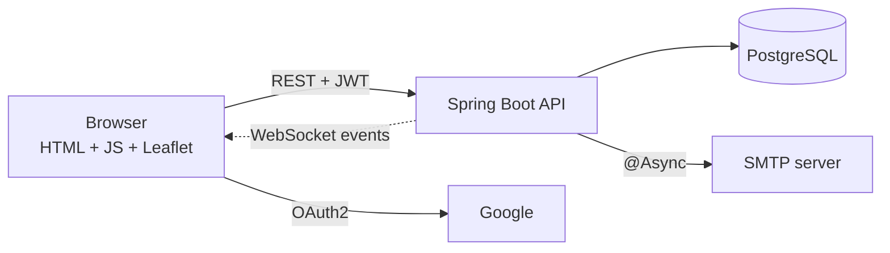

[README.md](https://github.com/user-attachments/files/35039942/README.md)
# Emergency Notification System (ENS)

A client-server application for sending emergency alerts. An administrator creates an alert with a type, a message and a location on the map, and every registered user gets it by email. The alert shows up on a live map until it is marked as resolved.

Built as a learning project to practise Spring Boot, Spring Security, PostgreSQL and asynchronous processing.

## Features

- **Alerts** — create, list, resolve and delete emergency alerts with type, message and coordinates
- **Email notifications** — every new alert is emailed to all users in the background (`@Async`), so the API responds immediately
- **Live map** — active alerts are shown on an interactive map (Leaflet / OpenStreetMap)
- **Real-time events** — the server publishes `CREATED`, `RESOLVED` and `DELETED` events over WebSocket (STOMP) to `/topic/notifications`
- **Authentication** — registration and login with email and password (BCrypt + JWT), or sign-in with Google (OAuth2)
- **Roles** — `USER` and `ADMIN`; the admin API is available only to admins
- **User profile** — personal and emergency medical data: blood type, allergies, chronic diseases, emergency contact, avatar
- **Password reset** — a one-time token with an expiry date is sent by email
- **Admin panel** — manage users and alerts

## Tech stack

| Layer | Technologies |
| --- | --- |
| Backend | Java 25, Spring Boot 3.5, Spring Web, Spring Data JPA / Hibernate, Spring Security, JWT (jjwt), OAuth2 Client, WebSocket (STOMP), Spring Mail |
| Database | PostgreSQL 15 |
| Client | HTML, CSS, JavaScript, Leaflet |
| Tools | Maven, Docker Compose |

## Architecture



The backend follows a layered structure: **controller → repository / service → database**. Requests are authenticated by a JWT filter: the token is issued at login and sent by the client in the `Authorization: Bearer <token>` header.

## API

| Method | Endpoint | Description | Access |
| --- | --- | --- | --- |
| POST | `/api/auth/register` | Register a new user | Public |
| POST | `/api/auth/login` | Log in, returns a JWT | Public |
| GET | `/api/auth/google/success` | Google sign-in callback, returns a JWT | Public |
| POST | `/api/auth/forgot` | Send a password reset email | Public |
| POST | `/api/auth/reset` | Set a new password with the reset token | Public |
| GET | `/api/notifications` | All alerts | User |
| GET | `/api/notifications/active` | Active alerts | User |
| POST | `/api/notifications` | Create an alert and email all users | User |
| PUT | `/api/notifications/{id}/resolve` | Mark an alert as resolved | User |
| DELETE | `/api/notifications/{id}` | Delete an alert | User |
| GET | `/api/user/me` | Current user profile | User |
| PUT | `/api/user/update` | Update the profile | User |
| POST | `/api/avatar/upload` | Upload an avatar | User |
| GET / PUT / DELETE | `/api/admin/users`, `/api/admin/users/{id}` | Manage users | Admin |

WebSocket endpoint: `/ws` (SockJS), topic: `/topic/notifications`.

## Data model

- **User** — name, email, phone, role, login provider (`LOCAL` / `GOOGLE`), medical data, avatar
- **Notification** — message, type, latitude, longitude, status (`active` / `resolved`), timestamp, author
- **ResetToken** — email, token, expiry date

A user has many notifications (`@OneToMany` / `@ManyToOne`).

## Project structure

```
backend/ens/src/main/java/com/example/ens/
├── config/        Security, WebSocket, async and web configuration
├── controller/    REST controllers
├── model/         JPA entities: User, Notification, ResetToken
├── repository/    Spring Data JPA repositories
├── security/      JWT service and filter
└── service/       Email sending and event broadcasting
backend/ens/src/main/resources/
├── static/        Client pages: auth, map, admin, profile
└── application.properties
```

## Getting started

**Requirements:** JDK 25, Docker.

1. Clone the repository:

   ```bash
   git clone https://github.com/denis-buimistr/emergency-notification-system.git
   cd emergency-notification-system
   ```

2. Start PostgreSQL:

   ```bash
   docker compose up -d
   ```

   The database is available on `localhost:5433`.

3. Create `backend/ens/.env` from `.env.example` and fill in your values:

   ```
   JWT_SECRET=your-long-random-secret
   GOOGLE_CLIENT_ID=...
   GOOGLE_CLIENT_SECRET=...
   MAIL_HOST=smtp.gmail.com
   MAIL_PORT=587
   MAIL_USERNAME=your-email@gmail.com
   MAIL_PASSWORD=your-app-password
   ```

   For Gmail, use an [app password](https://support.google.com/accounts/answer/185833), not your account password.

4. Run the application:

   ```bash
   cd backend/ens
   ./mvnw spring-boot:run
   ```

5. Open `http://localhost:8080/auth.html`.

## Roadmap

- Show alerts on the map in real time through the WebSocket subscription instead of polling
- Allow creating and deleting alerts only for the `ADMIN` role
- Move logic from controllers into services and return DTOs instead of entities
- Use enums for roles and statuses
- Manage the database schema with Flyway instead of `ddl-auto=update`
- Add unit and integration tests
- Add SMS and push notification channels

## Author

**Denis Buimistr** — [LinkedIn](https://www.linkedin.com/in/denis-buimistr/) · [GitHub](https://github.com/denis-buimistr)
